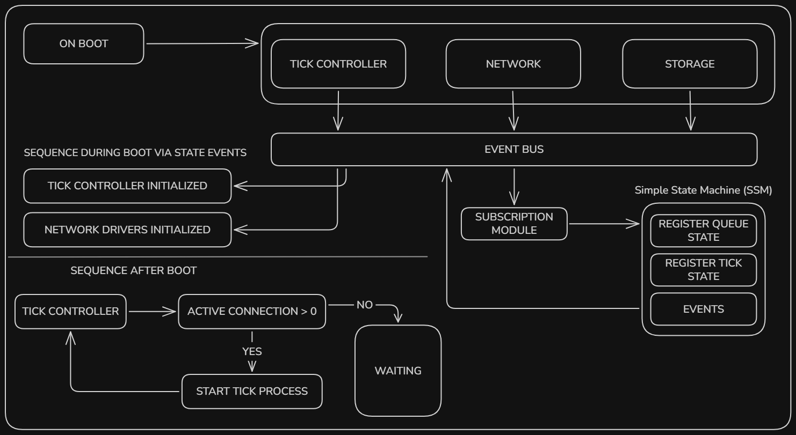

## 1. State Machine-Based Tick Execution Gate

Rather than introducing a fixed startup grace period (e.g. 2000ms), the Tick Controller will use a state-machine-based approach to determine whether queue execution is permitted.

This behavior will specifically apply to the Persistent Runtime when the queue consumer is configured as a socket consumer.

Before executing a tick, the Tick Controller will query the network layer for the currently connected workers associated with the queue.

If no active socket workers are available, the Tick Controller will not initiate tick execution. Instead, it will remain in a waiting state until the network layer reports a worker lifecycle event.

The state transitions will be driven by worker connection events:

- **Worker Connected:** When a worker connects and registers to a queue, the Tick Controller can transition the queue into an executable state.
- **Worker Disconnected:** When a worker disconnects, the Tick Controller reevaluates the queue's availability and can stop further tick execution if no active workers remain.

This avoids relying on arbitrary startup delays and makes tick execution dependent on the actual availability of socket consumers.

## 2. Worker Registration Reconciliation

The second part addresses stale worker-slot registrations in Redis.

When a socket worker successfully connects and registers to a queue, the engine will trigger an immediate worker-slot reconciliation for that queue.

The intention is to ensure that the newly connected worker can participate in job dispatch without waiting for previously registered slots to expire through their TTL.

This reconciliation will be triggered directly by the worker connection lifecycle rather than relying exclusively on the regular tick execution cycle.

For example, when a worker registers to `q_5`, the corresponding queue's worker-slot state will be reevaluated so that available execution capacity can be utilized immediately.

This is particularly important when the queue previously experienced rejected tick executions that left stale worker registrations behind.

## 3. Design Direction

The proposed approach focuses on two responsibilities:

**Execution readiness:** The Tick Controller determines whether socket consumers are actually available before allowing tick execution in the Persistent Runtime.

**Worker-slot consistency:** Worker connection events trigger reconciliation of the corresponding queue's registered worker capacity.

Together, these mechanisms are intended to eliminate the dependency on fixed startup delays and prevent stale worker registrations from unnecessarily delaying job dispatch.